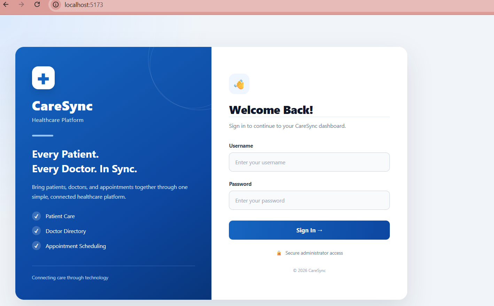
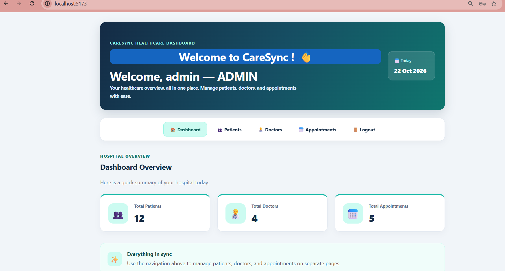
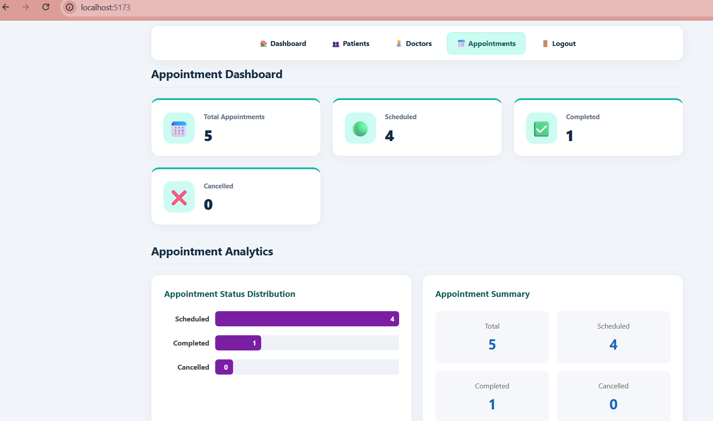
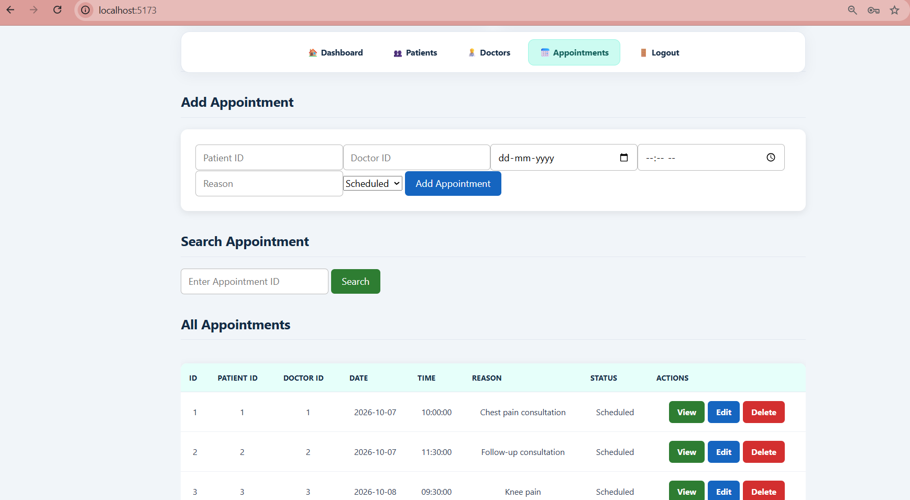
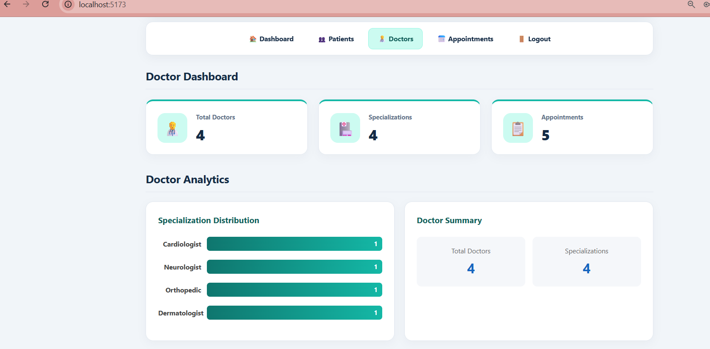
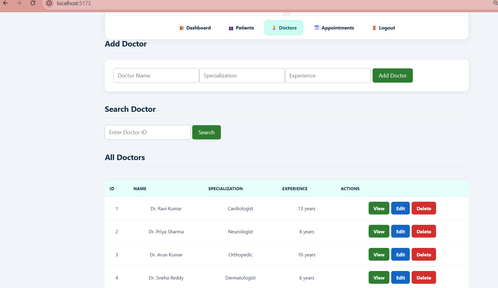
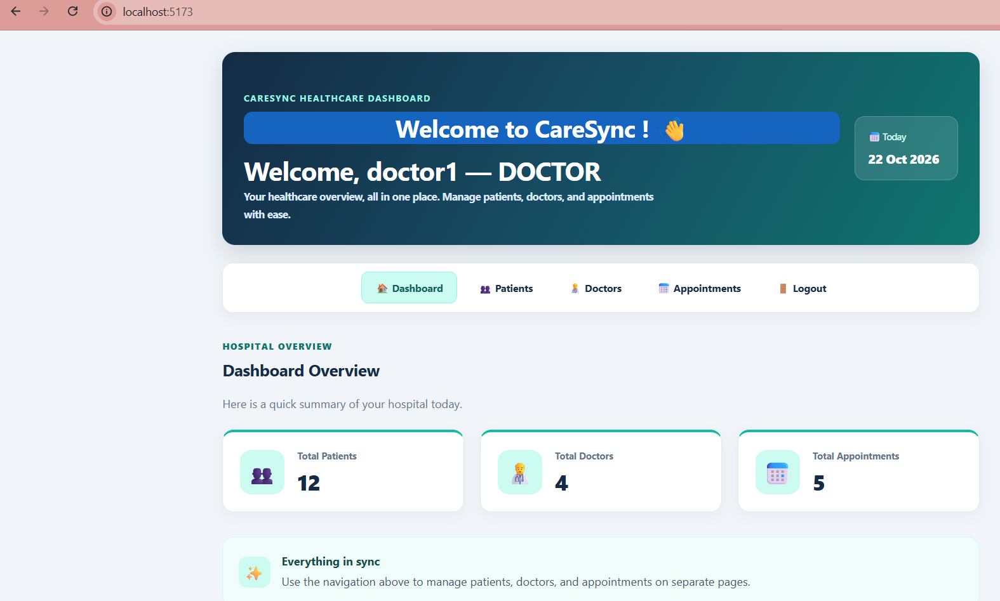
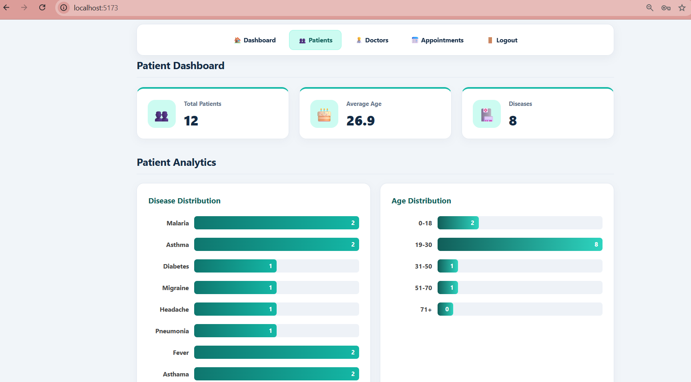
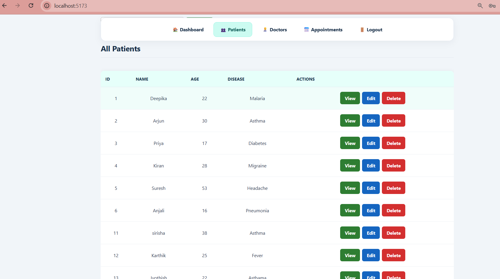
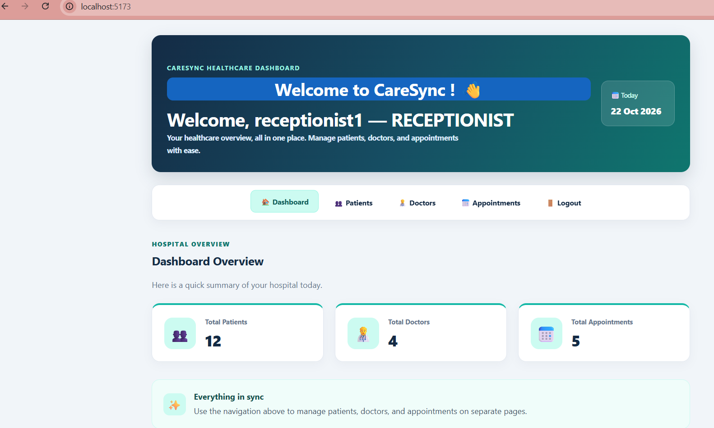

# CareSync — Healthcare Dashboard

CareSync is a healthcare application built with React. It provides a user-friendly interface for managing doctors, patients, and appointments, with role-based access for administrators, doctors, and receptionists.

## 🔗 Related Projects

- **Frontend:** [CareSync Frontend](https://github.com/Jayachandra69/caresync-frontend)
- **Backend:** [CareSync Healthcare Backend](https://github.com/Jayachandra69/caresync-healthcare-dashboard)

## ✨ Features

* User authentication and logout
* Role-based dashboards for Admin, Doctor, and Receptionist
* Doctor management
* Patient management
* Appointment management
* Integration with a Spring Boot REST API
* Session-based authentication

## 🛠️ Technology Stack

* React
* JavaScript
* Vite
* HTML5
* CSS3
* Spring Boot REST API
* MySQL database through the backend

## 📸 Application Screenshots

### Login Page



### Admin Login



### Appointments Dashboard



### Appointment Details



### Doctor Dashboard



### Doctor Details



### Doctor Login



### Patient Dashboard



### Patient Details



### Receptionist Login



## ⚙️ Prerequisites

* Node.js
* npm
* A running CareSync backend

## 🚀 Run Locally

### 1. Clone the repository

```bash
git clone https://github.com/Jayachandra69/caresync-frontend.git
```

### 2. Open the project folder

```bash
cd caresync-frontend
```

### 3. Install dependencies

```bash
npm install
```

### 4. Configure the backend URL

Create or update `.env.development` in the project root:

```env
VITE_API_URL=http://localhost:1222
```

Ensure the Spring Boot backend is running at the configured address.

### 5. Start the frontend

```bash
npm run dev
```

Open the local URL displayed in your terminal, typically `http://localhost:5173`.

## 🔌 Backend Integration

The frontend communicates with the CareSync Spring Boot backend through REST API endpoints.

**Backend repository:**
https://github.com/Jayachandra69/caresync-healthcare-dashboard

The API base URL is configured through `VITE_API_URL`.

## 🔐 Security

* Authentication is handled through the backend.
* Access to protected operations depends on backend authorization.
* Never store database passwords or other secrets in frontend environment variables.
* Environment variables prefixed with `VITE_` are exposed to frontend code and must not contain secrets.

## 📄 License

No open-source license has been specified for this project yet.
